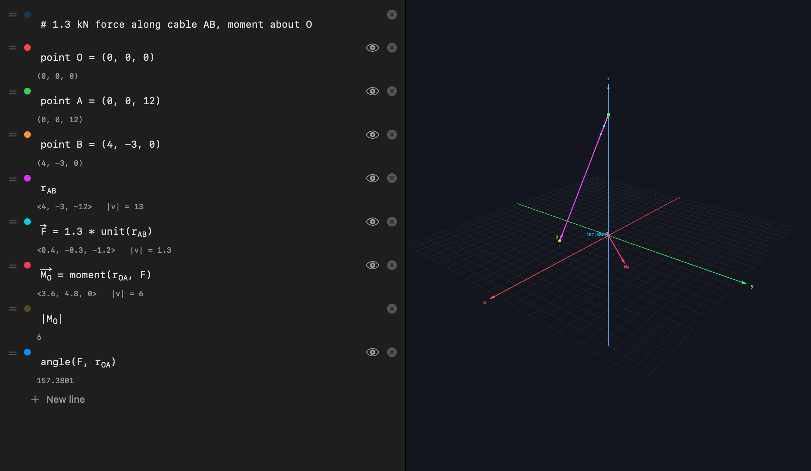
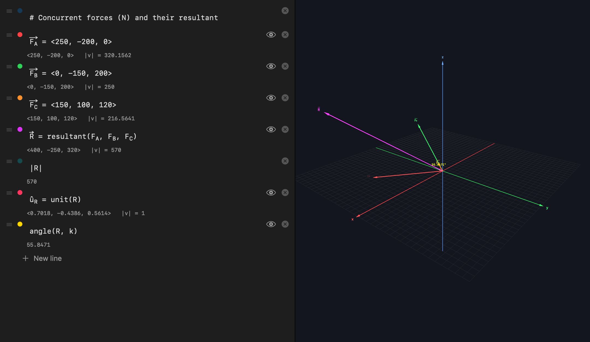
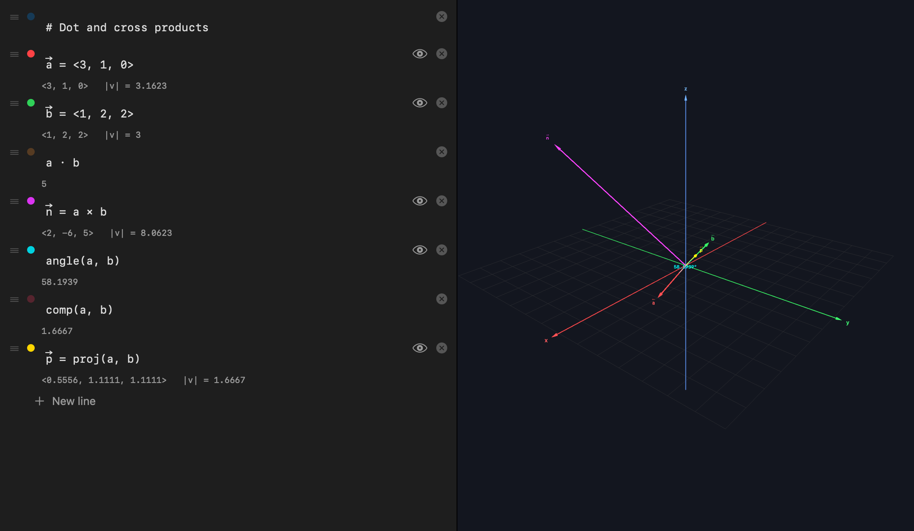
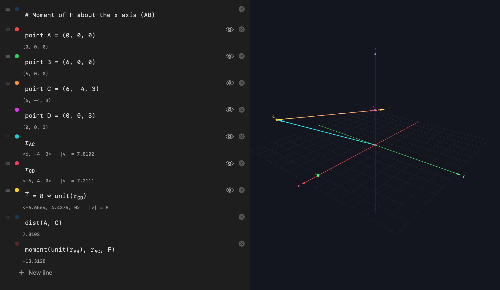
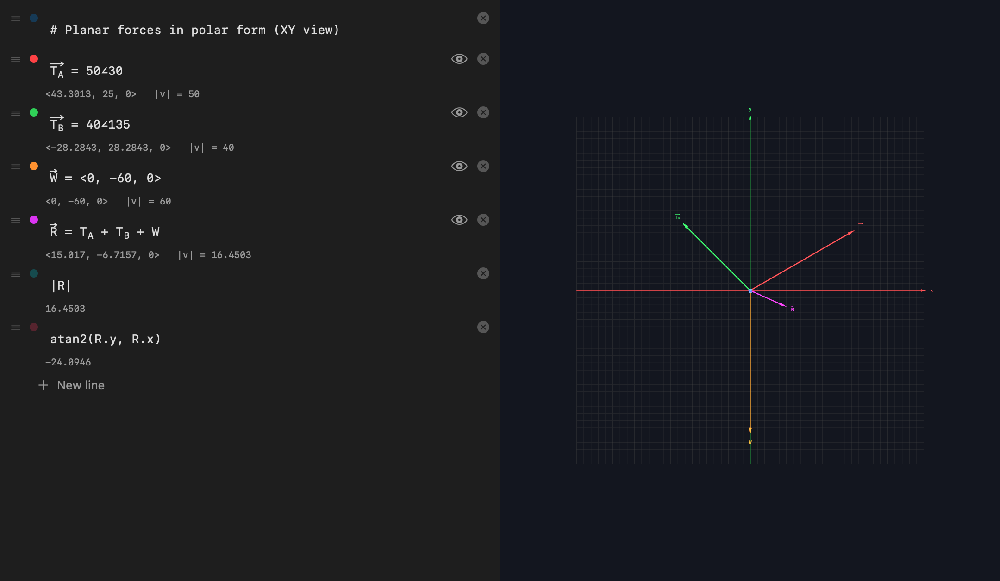
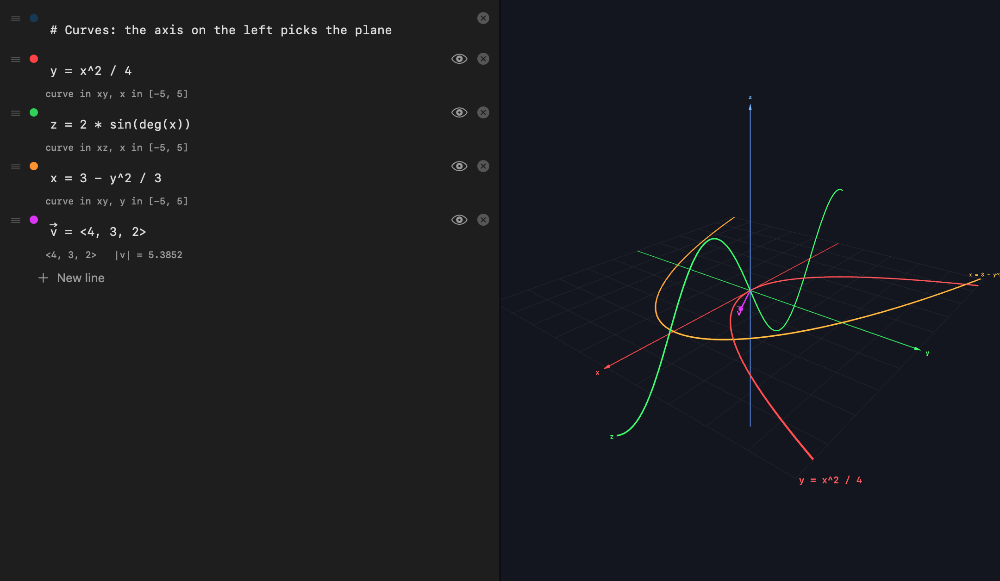
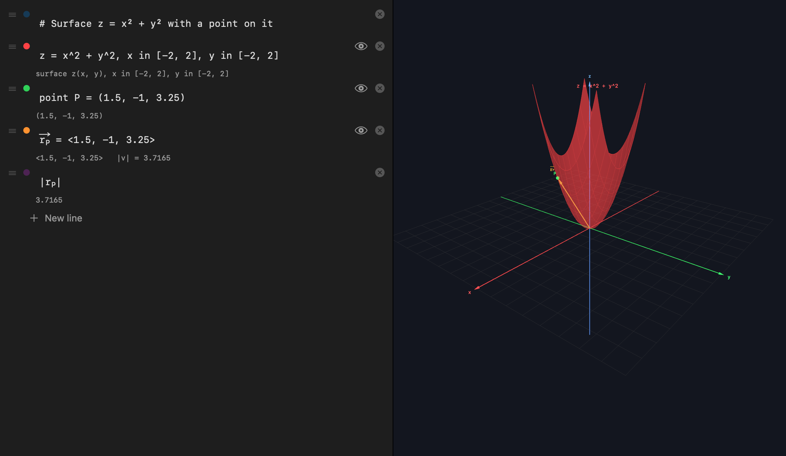

> **Retired project.** VectorLab is no longer maintained; it's kept here as an archive. Its ideas carried on in [Thuban Graph](https://github.com/ChancellorVerdery/thuban-graph).

# VectorLab

A native macOS notebook for statics: type vectors in textbook notation on the left, see them drawn in 3D on the right.



## Why

Statics homework is mostly vector bookkeeping: position vectors between points, unit vectors along cables, resultants, dot and cross products, moments. It's easy to get a sign or a component wrong and never notice. VectorLab was built to check that work visually. You write each step the way it appears on paper, every line re-evaluates as you type, and the vectors appear in a 3D scene where a wrong direction is obvious.

## The last iteration: Trihedron

The final round of work renamed the app **Trihedron** and added graphing. That iteration was never finished, but it builds and all of its tests pass, so it is the code on `main`. The Swift targets, the app bundle and the scripts all use the new name: `Trihedron`, `TrihedronCore`, `TrihedronScene`. The project and this repo are still called VectorLab.

What the rename iteration added:

- **Graphs in the same 3D scene as the vectors.** A definition whose right-hand side uses an axis name (`x`, `y`, `z`) that nothing above has defined is drawn as a graph. The name on the left is the dependent axis and picks the plane: `y = x^2` is a curve in the xy plane, `z = sin(deg(x))` a curve in xz, `z = x^2 + y^2` a surface over xy.
- **Optional domains.** `y = x^2, x in [-3, 3]` (or `x ∈ [-3, 3]`). Without one, a graph spans the current axes and is clipped to them, so it never makes the axes grow. With a written domain, the whole range is drawn and the axes grow to fit it.
- **Careful sampling.** Curves use 200 samples and surfaces a 60 × 60 grid. Where the expression is undefined (`ln` of a negative, `1/x` at 0), a curve breaks and a surface leaves a hole instead of spiking.
- **Hidden lines no longer size the axes.** A line you have hidden still defines its names, but its geometry no longer sizes the axes a graph spans.
- **Other changes:**
  - A "Graph" section in the notation cheat sheet.
  - A one-time copy of a notebook saved under the old VectorLab name to the new location.
  - About 40 new tests for graphing and graph rendering.

## Features

- **Live notebook.** One expression per line, re-evaluated top to bottom on every edit. Each line shows its result (components and magnitude for vectors, a number for scalars) right under it.
- **Textbook notation.** `<1, 2, 3>`, `3i + 4j - 5k`, points `(x, y, z)`, `r_AB` between named points, `50∠30` polar form, `·` and `×` operators, Greek letters, `\hat` and `\vec`.
- **Notation as a teaching aid.** Vectors get an arrow over their name and unit vectors get a hat automatically, and the mark follows the value. A name written with an explicit hat (`û`) must really have magnitude 1, or the line reports an error.
- **Statics functions.** `moment(r, F)`, moment about an axis, `resultant(…)`, `proj`/`comp`, `angle` (also drawn as an arc in the scene), `dist`, scalar triple product, degree-based trig.
- **Graphing** of curves and surfaces next to the vectors (Trihedron iteration, above).
- **3D viewport (SceneKit).** z-up axes and grid that resize to the content, labeled arrows and points, camera presets (Iso, XY, XZ, YZ), fit-to-content, and toggles for axes, grid and arrowheads. Arrow thickness and label size stay constant on screen as you zoom.
- **Per-line control.** Color dot per line, show/hide in the scene, drag to reorder.
- **Export and help.** Save the viewport as a PNG, and a built-in notation cheat sheet.
- **Autosave** of the notebook to `~/Library/Application Support/Trihedron/workspace.json`.
- **Tests.** 246 tests covering the lexer, parser, evaluator, worked statics problems, graphing, scene geometry and an offscreen render.

## Notation

```
a = <1, 2, 3>              vector — arrow (or hat when |a| = 1) renders automatically
\vec F = cos(30)i + sin(30)j   component form; i j k (or î ĵ k̂) multiply implicitly
A = (0, 0, 4)              parentheses make a point ('point A = …' also works)
r_AB                       B − A once points A and B exist (drawn from A)
\hat u = unit(F)           defines û, distinct from u — must be a true unit vector
\vec T = 50∠30             2D polar: magnitude ∠ angle in degrees (also 50 @ 30)
m = 12.5                   scalars use plain names
# heading                  comment line

a + b   a - b   2*a        arithmetic
r = Rû                     hatted symbols juxtapose: R·û  (û finds u when |u| = 1)
a * b   a · b   dot(a,b)   dot product
a × b   cross(a,b)         cross product
|a|     mag(a)             magnitude
angle(a, b)                angle in degrees (draws the arc in-scene)
proj(a, b)  comp(a, b)     vector / scalar projection of a onto b
F.x  F.y  F.z              components
moment(r, F)               r × F
moment(axis, r, F)         scalar moment about an axis
resultant(F1, F2, …)       sum of forces
dist(A, B)  triple(a,b,c)  distance, scalar triple product
sin cos tan …              degree-based; asin/acos/atan/atan2 return degrees
sqrt ln log exp pi e       scalar math;  rad(x) / deg(x) convert

y = x^2                    curve in the xy plane (x unbound)
z = sin(deg(x))            curve in the xz plane
x = y^2                    curve in the xy plane, x as a function of y
z = x^2 + y^2              surface over the xy plane
y = x^2, x in [-3, 3]      explicit domain (x ∈ [-3, 3] also parses)
z = x*y, x in [0, 2], y in [0, 2]
```

Conventions: z is up (statics style), trig is in degrees, and `i j k π e origin` are reserved. `x`, `y` and `z` are not reserved: once `x = 3` is defined, `y = x^2` is just the number 9. Because trig is in degrees, `z = sin(x)` over ±5 is nearly flat; write `z = sin(deg(x))` for the familiar wave.

Typing a space (or Return) renders finished notation in place: `\hat u` → û, `\vec F` → F⃗, `\theta` → θ, `< >` → ⟨ ⟩. Return again commits the line. The rendered form is real syntax: û is a distinct variable, F⃗ ≡ F, Greek letters are plain identifiers, and `·` `×` `√` `π` `∠` all parse. Letter subscripts (`r_AB`) are styled as subscripts without changing the underlying text.

## Screenshots

<table>
  <tr>
    <td></td>
    <td></td>
  </tr>
  <tr>
    <td>Concurrent forces and their resultant</td>
    <td>Dot and cross products, angle, projection</td>
  </tr>
  <tr>
    <td></td>
    <td></td>
  </tr>
  <tr>
    <td>Points, position vectors, moment about an axis</td>
    <td>Planar forces in polar form (XY view)</td>
  </tr>
  <tr>
    <td></td>
    <td></td>
  </tr>
  <tr>
    <td>Graphing: the left-hand axis picks the plane</td>
    <td>Graphing: a surface with a point and position vector</td>
  </tr>
</table>

## Branches

- `main`: the final Trihedron iteration, plus the overnight notes, this README and the screenshot mode.
- `worktree-build`: the VectorLab history before the rename.
- `wip/trihedron-rename`: the rename and graphing work exactly as it was left, as a single uncommitted-work snapshot.
- `wip/night-notes`: `NIGHT-NOTES.md` on its own. These are the running notes from the review-and-fix passes, recording each bug found, the test that caught it and the fix.

## Built with

- Swift 6 and SwiftUI (macOS 26)
- SceneKit for the 3D viewport
- Swift Package Manager, Swift Testing
- No third-party dependencies, no network access

Layout:

- `Sources/TrihedronCore`: lexer → parser → evaluator → grapher → `Engine.evaluate(lines)`; pure and UI-free
- `Sources/TrihedronScene`: SceneKit scene builder (arrows, points, arcs, curves, surfaces, axes, grid, camera)
- `Sources/Trihedron`: SwiftUI app (notebook, viewport, toolbar)
- `Tests/`: notation, evaluator, worked statics problems, graphing, scene geometry, offscreen render

## How it was built

I designed and directed VectorLab: what it should do, the notation, how it should look and behave, and which problems it had to get right. The code was written with Claude Code (AI-assisted).

## Build and run

Requires macOS 26 and a Swift 6.2 toolchain (Xcode 26). It was last built in 2026 and may need updates for newer toolchains.

```sh
swift build                      # debug build
swift test                       # run the test suite
swift run Trihedron              # launch from the package
scripts/make-app.sh              # build dist/Trihedron.app (release, ad-hoc signed)
scripts/make-app.sh --install    # also copy it to /Applications
```

You can also open `Package.swift` in Xcode and run the `Trihedron` scheme.

### Regenerating the screenshots

The images above come from a built-in screenshot mode, enabled by the `TRIHEDRON_SNAPSHOT` environment variable (it was `VECTORLAB_SNAPSHOT` before the rename). It loads each worked example into an in-memory notebook (your saved workspace is never read or written). It captures the window in-process, so no Screen Recording permission is needed, at 2x (or the display's scale if higher) with no downscaling. Then it writes the PNGs and quits:

```sh
swift build
TRIHEDRON_SNAPSHOT=docs/screenshots .build/debug/Trihedron
```

The examples live in `Sources/Trihedron/Snapshot.swift`. While it captures (about 15 seconds), the window floats in front on the sharpest display. If the notebook side comes out blank, the window was covered; run it again.

---

All rights reserved.
